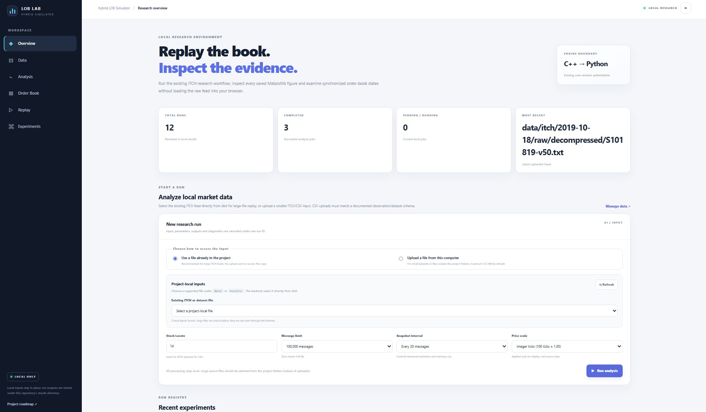
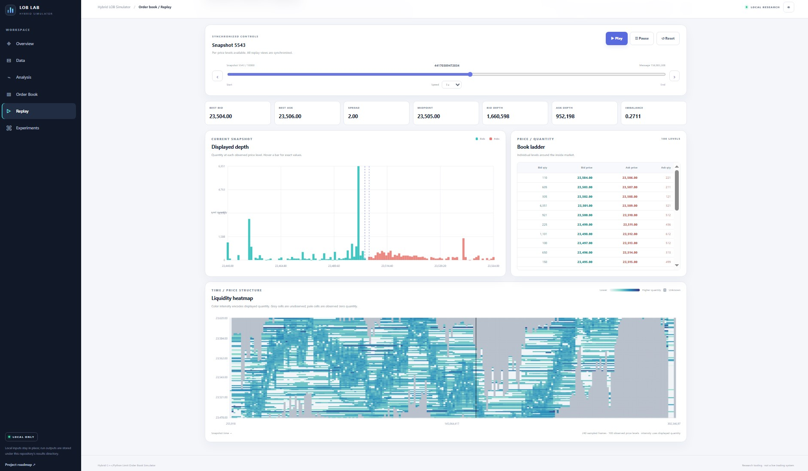
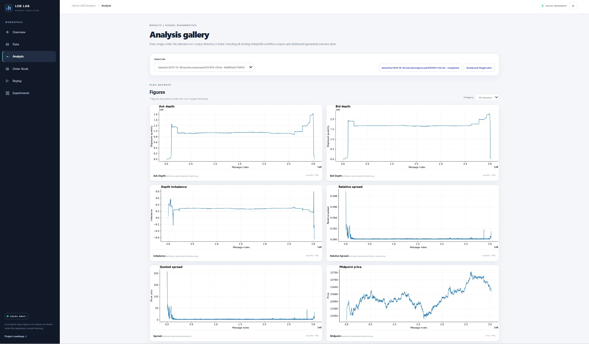
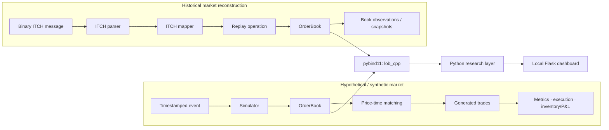
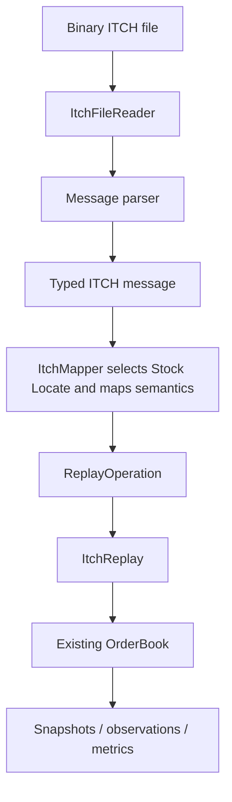

<div align="center">

# Hybrid C++/Python Limit Order Book Simulator

**A market-microstructure research workbench: C++ order-book mechanics, historical Nasdaq ITCH reconstruction, Python analysis, and a local visual dashboard.**

[](https://en.cppreference.com/w/cpp/20)
[](https://www.python.org/)
[](https://flask.palletsprojects.com/)
[](LICENSE)

[Repository](https://github.com/Jad-srifi/hft-orderbook-sim) · [Architecture notes](docs/ARCHITECTURE.md) · [Issues](https://github.com/Jad-srifi/hft-orderbook-sim/issues)

> **License:** Source-available under the [PolyForm Noncommercial License 1.0.0](https://polyformproject.org/licenses/noncommercial/1.0.0). Noncommercial use is permitted under its terms; commercial purposes require separate permission. This is **not an OSI-approved open-source license**. Previously distributed MIT-licensed versions remain subject to the rights granted with those versions.

</div>

---

## Start here

You do **not** need to understand every source file before using the project. Pick the path that fits what you want to do:

| Your goal                                    | Start here                                                        | What you get                                                                                           |
| -------------------------------------------- | ----------------------------------------------------------------- | ------------------------------------------------------------------------------------------------------ |
| **Explore data without writing code**        | [Run the local dashboard](#path-a-use-the-visual-dashboard)       | Upload/select a dataset, watch analysis progress, inspect plots and replay snapshots in a browser.     |
| **Run a repeatable research workflow**       | [Run the Python examples](#path-b-run-a-python-research-workflow) | Historical replay, sampled book observations, summary statistics, plots, and a JSON experiment record. |
| **Understand or extend the matching engine** | [Build and run C++](#path-c-work-directly-with-c)                 | Inspect the C++ core, run its demonstration, and study the order-book implementation.                  |

> **The 30-second explanation:** the order book is the engine's memory of resting buy and sell orders. The C++ core updates that state. Python calls into the same core to extract observations and run analysis. The dashboard gives you a browser interface to selected workflows. It is one engine with several ways to use it—not three different matching engines.

## What this project is—and is not

This repository combines:

- A **C++20 limit order book** with price-time priority, order tracking, modification, cancellation, and matching.
- A **deterministic event-driven simulator** for hypothetical order events.
- Read-only market-microstructure metrics, execution/slippage analysis, and inventory/cash/P&L accounting.
- A **Nasdaq TotalView-ITCH 5.0** binary parser, mapper, and replay path that reconstructs the displayed book from historical messages.
- A **pybind11 extension** (`lob_cpp`) and Python research workflows for extracting observations, generating features, summarizing results, and plotting. The current STL bindings convert containers into Python objects; zero-copy transfer is **not** claimed or demonstrated.
- A **local Flask dashboard** for file-based research runs, status/progress, snapshots, heatmap data, plots, and downloadable artifacts.
- C++ and Python tests, example programs, and benchmark/profiling tools.

This is a **simulation and historical-data research project**. It is not a broker connection, a live exchange gateway, a production execution system, or proof of a profitable strategy. A fast replay is not the same thing as a validated market model, and a feature calculation is not an investment result.

### Implementation map

The labels below describe the scope represented by the checked-in implementation. They do **not** mean every feature has been independently validated on every dataset or platform; use the test section for the exact validation commands and data requirements.

| Area                                                         | Status in this repository                 | What that means in practice                                                                                               |
| ------------------------------------------------------------ | ----------------------------------------- | ------------------------------------------------------------------------------------------------------------------------- |
| C++ order book and matching                                  | Implemented                               | Store orders, query quotes, apply supported operations, and generate synthetic matches.                                   |
| Simulator, metrics, execution, inventory                     | Implemented                               | Run hypothetical event sequences and calculate supported market/execution/accounting outputs.                             |
| Binary ITCH parsing and displayed-book replay                | Implemented for a defined message scope   | Decode supported messages and reconstruct the selected displayed book; this is not a full exchange model.                 |
| pybind11 module (`lob_cpp`)                                  | Implemented; built locally                | Python calls into the C++ implementation through a compiled extension.                                                    |
| Python research helpers and examples                         | Implemented for the workflows shown here  | Extract observations, prepare outputs, and plot research diagnostics; capabilities depend on the selected module/example. |
| Flask dashboard                                              | Implemented as a local research interface | Launch bounded runs, inspect progress/snapshots/plots, and access run artifacts in a browser.                             |
| Full feed and test data                                      | Supplied locally by the user              | Large historical data is intentionally not checked into Git; some integration tests require it.                           |
| Profitable strategy, live trading, complete exchange realism | Not claimed                               | The project does not establish any of these outcomes.                                                                     |

## A visual tour

The images below are illustrative project media, not performance evidence. Treat any placeholder artwork as a placeholder rather than a screenshot of a running application.

<table>
  <tr>
    <td width="50%" valign="top">
      <a href="docs/media/dashboard-overview.jpg">
        
      </a>
      <strong>1. Dashboard overview</strong>
      <p>Replace with a screenshot of the running research dashboard.</p>
    </td>
    <td width="50%" valign="top">
      <a href="docs/media/order-book-depth.jpg">
        
      </a>
      <strong>2. Order-book depth</strong>
      <p>Replace with an actual bid/ask depth chart or replay plot.</p>
    </td>
  </tr>
  <tr>
    <td width="50%" valign="top">
      <a href="docs/media/research-results.jpg">
        
      </a>
      <strong>3. Research outputs</strong>
      <p>Replace with genuine analysis plots and output artifacts.</p>
    </td>
    <td width="50%" valign="top">
      <a href="https://youtu.be/rBas32Tus-Y">
        
      </a>
      <strong>4. Watch the project walkthrough</strong>
      <p>Click the thumbnail to watch the project walkthrough on YouTube.</p>
    </td>
  </tr>
</table>

---

## Contents

- [Choose a workflow](#start-here)
- [System architecture](#how-the-system-fits-together)
- [Setup on Windows with MSYS2 UCRT64](#setup-windows--msys2-ucrt64)
- [Path A: dashboard](#path-a-use-the-visual-dashboard)
- [Path B: Python research](#path-b-run-a-python-research-workflow)
- [Path C: C++ core](#path-c-work-directly-with-c)
- [Historical ITCH explained](#historical-itch-replay-explained)
- [Data units and core rules](#data-units-and-core-rules)
- [Tests and benchmarks](#tests-and-benchmarks)
- [Repository map](#repository-map)
- [Troubleshooting](#troubleshooting)
- [Limitations, data, and license](#limitations-data-and-license)

## How the system fits together

There are two different ways to update a book. The distinction is essential.



### The easiest mental model

Imagine a marketplace with a waiting line of buyers and sellers:

- A **bid** is a resting buy order. The best bid is the highest buy price.
- An **ask** is a resting sell order. The best ask is the lowest sell price.
- A **price level** groups orders at the same price. The orders inside a level preserve arrival order (FIFO).
- The **matching engine** checks whether a new hypothetical order crosses the opposite side. If it does, it trades against resting liquidity at the resting order's price.
- The **historical replay engine** does something different: it reads what the exchange reported happened, and applies those historical state changes. It does **not** pretend those old exchange messages are new orders from your strategy.
- **Python** reads and analyses outputs from the C++ implementation. The core book and matching rules are not rewritten in Python or JavaScript.

### Who owns what?

| Component                         | Responsibility                                                                                              | What it should not do                                                  |
| --------------------------------- | ----------------------------------------------------------------------------------------------------------- | ---------------------------------------------------------------------- |
| `OrderBook`                       | Owns current bid/ask book state and matching mechanics.                                                     | Track portfolio P&L or independently re-interpret an ITCH byte stream. |
| `OrderMap`                        | Maps order IDs to side/price/index locations to avoid scanning the whole book for every lookup.             | Become a second owner of orders.                                       |
| `Simulator`                       | Processes timestamped/sequenced hypothetical events and collects generated trades.                          | Replay historical exchange executions as strategy orders.              |
| `MarketMetrics` / execution layer | Derive observations and execution-quality measures from book/trade context.                                 | Maintain a duplicate market state.                                     |
| `InventoryModel`                  | Maintains position, cash, average cost, and realized P&L; derives marked values.                            | Change the matching rules.                                             |
| ITCH parser / mapper / replay     | Decode raw binary messages, translate supported events, and apply historical updates.                       | Route historical execution messages through synthetic matching.        |
| `lob_cpp`                         | Exposes existing C++ types and operations to Python through pybind11.                                       | Act as a separate implementation of the order book.                    |
| Python research / Flask           | Prepare inputs, collect observations, calculate supported features, present progress, plots, and artifacts. | Claim a backtest or plot proves profitability.                         |

---

## Setup: Windows + MSYS2 UCRT64

The checked-in build script intentionally requires **MSYS2 UCRT64**. Use one consistent C++ compiler and Python installation. Do not mix UCRT64 Python with MINGW64 Python or a separate native Windows CPython when building/importing `lob_cpp`.

### 1. Install the prerequisites

Install MSYS2, then open the **MSYS2 UCRT64** terminal (not MSYS, not MINGW64, and not a generic PowerShell window). Make sure the terminal provides:

- `g++` with C++20 support;
- Python **3.14 or newer** from the same UCRT64 environment;
- the Python development library that matches that interpreter;
- `pip`, `pybind11`, `pytest`, `numpy`, and `matplotlib`.

Check the active tools before continuing:

```bash
echo "$MSYSTEM"                 # should print UCRT64
g++ --version
python --version                # pyproject.toml requires Python >= 3.14
python -m pybind11 --includes
```

Install the Python-side packages in that **same environment**:

```bash
python -m pip install --upgrade pip
python -m pip install -r requirements.txt
python -m pip install -r webapp/requirements.txt
```

`pyproject.toml` records the project metadata and Python minimum, but its declared dependency list is empty and it does not by itself compile the C++ extension. The dashboard's explicit requirements are in `webapp/requirements.txt` (`Flask` and `matplotlib`). The root requirements file includes the build, research, plotting, and test dependencies; the dashboard requirements file documents the dashboard runtime dependencies.

### 2. Get the project

```bash
git clone https://github.com/Jad-srifi/hft-orderbook-sim.git
cd hft-orderbook-sim
```

Run the remaining commands from the repository root in the UCRT64 terminal.

### 3. Build the C++ programs and Python extension

```bash
./scripts/build.sh
```

The script compiles the C++ sources with C++20, warnings enabled, and `-O2`; then it builds the example/replay/benchmark/profile executables, C++ test executables, and the `lob_cpp` Python extension. It ends by trying to import the extension with the selected Python interpreter.

Expected build outputs include:

```text
build/simulate.exe
build/replay_itch_main.exe
build/create_itch_samples_main.exe
build/inspect_itch_sample_main.exe
build/benchmark_main.exe
build/profile_main.exe
build/test_*.exe
python/lob_cpp<interpreter-specific extension suffix>
```

The extension suffix varies by Python build. Treat the generated `.pyd` as a **local build artifact**, not as portable source code. Rebuild it on the machine and with the interpreter that will use it.

### 4. Sanity-check the extension

```bash
PYTHONPATH="$PWD/python${PYTHONPATH:+:$PYTHONPATH}" python -c \
  'import lob_cpp; print("lob_cpp import OK:", lob_cpp.__file__)'
```

If this import fails, fix the interpreter/ABI or build setup before proceeding to the examples or dashboard.

---

## Path A: use the visual dashboard

**Best for:** someone who wants to explore a file, see the analysis process, and inspect outputs without writing Python.

### Launch it

Install the dashboard dependencies if you have not already, build the extension, then launch the server:

```bash
python -m pip install -r webapp/requirements.txt
./scripts/build.sh
./scripts/run_dashboard.sh
```

Open these local URLs in your browser:

- **Research workspace:** <http://127.0.0.1:8000/research>
- **Overview / project roadmap:** <http://127.0.0.1:8000/>

Stop the server with **Ctrl+C** in the terminal. The dashboard is a local application and binds to `127.0.0.1` by default.

### What to do in the browser

1. Open the research workspace.
2. Choose a project-local input under `data/` or `results/`, or upload a supported input.
3. For a historical ITCH file, use the **decompressed binary `.txt` file** and choose its Stock Locate ID. For a CSV, make sure its header matches one of the supported observation schemas below.
4. Set a reasonable message limit first (for example, `100000`) and choose a snapshot interval.
5. Start the run. Watch its status, progress, and outcome counters. A percentage is progress feedback, not a correctness certificate.
6. When the run completes, inspect the summary, plots, replay snapshots/depth, heatmap where available, and downloadable artifacts.
7. Open `results/dashboard/runs/` to inspect the files saved for a run.

### Input types

| Input                    | Use                                                         | Important details                                                                                                                                                                                |
| ------------------------ | ----------------------------------------------------------- | ------------------------------------------------------------------------------------------------------------------------------------------------------------------------------------------------ |
| Decompressed ITCH `.txt` | Reconstruct a historical displayed order book.              | This is a **binary protocol file** even though its extension is `.txt`; do not open and resave it as ordinary text.                                                                              |
| Observation `.csv`       | Plot/analyse an already extracted sequence of observations. | Must have a header and non-empty numeric observation rows. It does not re-run raw ITCH parsing.                                                                                                  |
| Gzip `.gz`               | Upload validation recognizes gzip files.                    | **Current limitation:** the replay runner itself rejects a `.gz` stream. Decompress the file first and run the resulting binary `.txt` file. Do not rely on a `.gz` upload to complete a replay. |

A CSV must contain at least one of these field groups (field names are case-insensitive):

- `midpoint`, `spread`, `bid_depth`, `ask_depth`; or
- `best_bid`, `best_ask`, `bid_depth`, `ask_depth`; or
- `bid`, `ask`, `bid_depth`, `ask_depth`.

Example header for an observation file:

```csv
timestamp_ms,message_index,best_bid,best_ask,midpoint,spread,relative_spread,bid_depth,ask_depth,imbalance
```

Additional recognized numeric fields include `trade_volume` and `trade_count`. Keep price/quantity units consistent across the file. The dashboard's default display price scale is `100`, which converts the project's common integer-cent representation (for example, `10000` → `100.00`) for display. Adjust it only when your source data uses a different scale.

### Dashboard defaults and practical limits

The current configuration defaults include:

| Setting                          |      Default | Meaning                                                                                                           |
| -------------------------------- | -----------: | ----------------------------------------------------------------------------------------------------------------- |
| `DASHBOARD_MAX_UPLOAD_MB`        |        `512` | Maximum upload size in MiB.                                                                                       |
| `DASHBOARD_MAX_REPLAY_MESSAGES`  | `20,000,000` | Maximum raw ITCH messages consumed by one run. `0` in the UI means full file, subject to this configured maximum. |
| `DASHBOARD_MAX_REPLAY_SNAPSHOTS` |     `10,000` | Maximum snapshots retained for a replay.                                                                          |
| `DASHBOARD_MAX_LEVELS_PER_SIDE`  |         `50` | Book levels captured per side in a snapshot.                                                                      |
| `DASHBOARD_MAX_HEATMAP_FRAMES`   |        `240` | Maximum heatmap frames generated for browser use.                                                                 |
| `DASHBOARD_MAX_HEATMAP_PRICES`   |        `100` | Maximum price rows represented in a heatmap.                                                                      |
| `DASHBOARD_MAX_CSV_ROWS_TO_SCAN` |  `5,000,000` | Maximum CSV rows scanned during validation.                                                                       |
| `PORT`                           |       `8000` | Local web-server port.                                                                                            |
| `DASHBOARD_HOST`                 |  `127.0.0.1` | Bind address; keep it loopback for a local-only workflow.                                                         |

Environment overrides should be used deliberately. Larger limits can increase CPU, memory, storage, and browser-rendering costs.

### Where dashboard results go

Each run is stored under a run-specific directory in:

```text
results/dashboard/runs/<run-id>/
├── input/       # saved uploaded input, when applicable
├── output/      # replay.json, plots, diagnostics, logs, and other outputs
└── metadata     # run status/configuration (stored by the run store)
```

The exact set of output files depends on the input and stages completed. Useful artifacts include `replay.json`, `dashboard_diagnostics.json`, generated plots, and `dashboard_error.log` if a run fails. Uploads and result files stay on the local machine; they are not automatically committed to Git.

### Dashboard API (for developers)

The frontend calls the Flask API registered in `webapp/routes.py`. The main routes are:

| Route                                  | Method | Purpose                                                                    |
| -------------------------------------- | ------ | -------------------------------------------------------------------------- |
| `/api/health`                          | `GET`  | Health check.                                                              |
| `/api/runs`                            | `GET`  | List recent runs; accepts a `limit` query parameter.                       |
| `/api/runs`                            | `POST` | Create a run from an uploaded input.                                       |
| `/api/local-inputs`                    | `GET`  | Discover supported files under the project's `data/` and `results/` roots. |
| `/api/runs/local`                      | `POST` | Create a run from a project-local input path.                              |
| `/api/runs/<run_id>`                   | `GET`  | Read one run's public status/metadata.                                     |
| `/api/runs/<run_id>/plots`             | `GET`  | List available plots.                                                      |
| `/api/runs/<run_id>/artifacts`         | `GET`  | List JSON/artifact outputs.                                                |
| `/api/runs/<run_id>/snapshots`         | `GET`  | Fetch a page of replay snapshots using `start` and `limit`.                |
| `/api/runs/<run_id>/snapshots/<index>` | `GET`  | Fetch one snapshot.                                                        |
| `/api/runs/<run_id>/heatmap`           | `GET`  | Get a bounded heatmap payload where available.                             |

The route file also includes endpoints for serving an individual plot or artifact. Treat this API as a local research interface, not a hardened public service.

---

## Path B: run a Python research workflow

**Best for:** reproducible experiments and analysis without rewriting the C++ matching logic.

The examples add the project's `python/` directory to `sys.path` and use the local `lob_cpp` extension. Run them from the repository root after building the extension.

### B1. Run the synthetic matching example

```bash
python examples/basic_simulation.py
```

The example creates a bid and ask, sends a marketable incoming buy order, and prints the trade returned by the C++ matching engine. The important bits are:

```python
import sys
from pathlib import Path

# Run from the repository root; the built extension lives in ./python.
sys.path.insert(0, str(Path("python").resolve()))
import lob_cpp

book = lob_cpp.OrderBook()
book.add(lob_cpp.Order(1, lob_cpp.Side.BUY, 10000, 10))
book.add(lob_cpp.Order(2, lob_cpp.Side.SELL, 10010, 6))

incoming = lob_cpp.Order(3, lob_cpp.Side.BUY, 10010, 4)
trades = book.process_order(incoming)

for trade in trades or []:
    print(trade.price, trade.quantity)
```

Read the numbers correctly:

- `10000` is a price of `100.00` in the project's common integer-cent representation.
- `10010` is `100.10`.
- The incoming buy is willing to pay `100.10`, so it crosses the resting ask at `100.10`.
- The trade quantity is `4`; the resting ask has `2` units left.

`book.add(...)` adds resting liquidity. `book.process_order(...)` submits an incoming order to the matching engine and returns generated trades.

### B2. Replay historical ITCH and generate research outputs

The example's defaults expect the historical file at one of these locations, checked in order:

```text
data/itch/2019-10-18/decompressed/S101819-v50.txt
data/itch/2019-10-18/raw/S101819-v50.txt.gz
```

For replay, use the decompressed `.txt` file. The `.gz` candidate is only a location fallback in the research example and does **not** mean the C++ binary reader can consume gzip directly.

Run a small bounded experiment first:

```bash
python examples/itch_research_workflow.py \
  --file data/itch/2019-10-18/decompressed/S101819-v50.txt \
  --stock-locate 123 \
  --max-messages 100000 \
  --snapshot-interval 10 \
  --no-show
```

Useful options:

| Option                  | Default / example                 | Meaning                                                                                        |
| ----------------------- | --------------------------------- | ---------------------------------------------------------------------------------------------- |
| `--file PATH`           | Auto-detect; shown above          | Input ITCH file.                                                                               |
| `--stock-locate N`      | `123`                             | Security identifier used by the ITCH feed for selecting a book. It is **not** a ticker symbol. |
| `--list-stocks`         | Off                               | Print symbols and their Stock Locate IDs, then exit.                                           |
| `--max-messages N`      | `20000000`; use `0` for full file | Number of raw feed messages to consume, including other securities and ignored message types.  |
| `--snapshot-interval N` | `10`                              | Capture a snapshot every N successfully applied replay operations, not every N raw messages.   |
| `--output-dir PATH`     | Auto-generated                    | Output directory for plots, diagnostics, and experiment output.                                |
| `--no-show`             | Off                               | Save plots without opening interactive plot windows.                                           |

To list securities in the source file:

```bash
python examples/itch_research_workflow.py \
  --file data/itch/2019-10-18/decompressed/S101819-v50.txt \
  --list-stocks
```

To process the entire file, use `--max-messages 0`. Start with a smaller value while checking your data path, chosen Stock Locate, and output before committing to a full-day replay.

By default, the workflow writes to a run-specific directory similar to:

```text
results/itch_results_123_100000/
├── itch_research_experiment.json
├── snapshot_diagnostics.json
├── best_quotes.png
├── midpoint.png
├── book_depth.png
├── spread_distribution.png
└── ... other generated plots
```

The exact files depend on the successful workflow and can change as the research code evolves. The experiment record stores configuration, feature definitions, summary results, diagnostics, and plot names. It is the starting point for inspecting how a result was generated—not a substitute for reading the code or checking the data.

### B3. Common helper scripts

The repository includes scripts to make common tasks easier:

```bash
./scripts/run_simulation.sh
./scripts/replay_historical.sh
./scripts/run_itch_research.sh --max-messages 100000 --snapshot-interval 10 --no-show
./scripts/list_stocks.sh
./scripts/run_benchmark.sh
./scripts/run_all_examples.sh
```

Check a script's current argument handling with `--help` or inspect the script before running a long job. Historical input and output paths are machine-local and may need to be supplied explicitly.

### B4. Main research-layer modules

| Location                                | Responsibility                                                                          |
| --------------------------------------- | --------------------------------------------------------------------------------------- |
| `python/lob_cpp*.pyd`                   | Generated pybind11 extension; compiled from C++ sources.                                |
| `python/lob.py`, `python/itch.py`       | Thin helpers around bound C++ book/replay types.                                        |
| `python/itch_directory.py`              | Reads the ITCH Stock Directory and helps list securities/Stock Locate IDs.              |
| `python/backtests/historical_replay.py` | High-level Python wrapper around the C++ historical reader/parser/mapper/replay path.   |
| `python/observations.py`                | Converts book states to consistently shaped research observations.                      |
| `python/datasets.py`                    | Prepares/writes observations as datasets.                                               |
| `python/research/`                      | Reusable statistical and microstructure research utilities.                             |
| `python/plots/`                         | Reusable visualization helpers.                                                         |
| `examples/`                             | Runnable end-to-end examples of simulation, replay, extraction, features, and analysis. |

The supported workflow is **reconstruct/extract → validate observations → define features → analyse → record outputs**. Do not assume that every conceivable feature, model, backtest, or empirical paper is already implemented. Read the relevant example/module for its current outputs and assumptions.

---

## Path C: work directly with C++

**Best for:** changing the engine, learning how the matching logic works, or profiling its performance.

### C1. Run the bundled C++ demonstration

After `./scripts/build.sh`:

```bash
./build/simulate.exe
```

The application walks through the book, order tracking, cancellation/modification, synthetic matching/simulation, metrics, execution context, inventory/P&L, and a small in-memory ITCH demonstration. It is a demonstration executable, not an exchange connection.

### C2. Small standalone order-book example

The following uses the real `OrderBook`, `Order`, `Side`, and `Trade` interfaces from the C++ headers. Prices are integer ticks; for this project's common representation, `10000` means `100.00`.

```cpp
#include <iostream>
#include <order.hpp>
#include <order_book.hpp>
#include <types.hpp>

int main() {
    OrderBook book;

    book.add(Order{1, Side::BUY, 10000, 10});
    book.add(Order{2, Side::SELL, 10010, 6});

    Order incoming{3, Side::BUY, 10010, 4};
    const auto trades = book.process_order(incoming);

    for (const Trade& trade : trades) {
        std::cout << "price=" << trade.price
                  << " quantity=" << trade.quantity << '\n';
    }

    std::cout << "best bid=" << book.best_bid() << '\n';
    std::cout << "best ask=" << book.best_ask() << '\n';
}
```

The public header directory is `cpp/include/lob/`. The build script is the canonical project build route. After running `./scripts/build.sh`, the core object files are available under `build/obj/`; you can compile this snippet when saved as `examples/quickstart.cpp` from the repository root:

```bash
g++ -std=c++20 -Wall -Wextra -pedantic -O2 \
  -Icpp/include/lob \
  examples/quickstart.cpp build/obj/*.o \
  -o build/quickstart.exe
./build/quickstart.exe
```

This link command assumes the build script has already populated `build/obj/` and that those object files do not contain another program entry point. If the build layout changes, follow the current source/linking pattern in `scripts/build.sh` rather than copying only one `.cpp` file.

### C3. Historical replay executable

The C++ replay tool accepts a file, Stock Locate, and either a count or `all`:

```bash
./build/replay_itch_main.exe \
  data/itch/2019-10-18/decompressed/S101819-v50.txt \
  123 \
  1000
```

Use `all` as the third argument to read to end-of-file. The program reports its replay counters and fails with diagnostics when it encounters a fatal file, parsing, mapping, or replay error. Use bounded counts first when validating a new file.

### C4. Where to study the core

```text
cpp/include/lob/      # public C++ types and class declarations
cpp/src/              # implementations of the core components
cpp/app/              # executable entry points
cpp/bindings/         # pybind11 C++/Python boundary
tests/cpp/             # C++ test sources
```

Important implementation invariants:

1. `OrderBook` owns its bid and ask `std::vector<PriceLevel>` containers; each `PriceLevel` owns its orders and aggregate quantity.
2. `OrderMap` stores an `OrderLocation` (side, price, index), not a separately owned order object or a second pointer-based order store.
3. Orders at one price preserve FIFO order. Price levels are ordered so the best bid/ask can be queried.
4. Matching takes place in the C++ core. The generated trade price is the resting order's price.
5. Simulator execution analysis captures the arrival midpoint **before** matching changes the book.
6. An absent best bid or ask is represented as `0` by the current quote API. Do not interpret it as a valid traded price.

For the complete class-by-class explanation and design history, see [`docs/ARCHITECTURE.md`](docs/ARCHITECTURE.md).

---

## Historical ITCH replay explained

Nasdaq TotalView-ITCH is a binary market-data protocol. Each message is framed and decoded, then mapped to an operation the current replay implementation understands.



The mapper's supported displayed-book updates include these message families:

| Message family | Current replay meaning (simplified)                                                                                                             |
| -------------- | ----------------------------------------------------------------------------------------------------------------------------------------------- |
| `A`, `F`       | Add displayed order (with/without attribution details).                                                                                         |
| `E`, `C`, `X`  | Reduce the quantity of a resting historical order by the reported executed/cancelled amount. The `X` message carries the cancelled share count. |
| `D`            | Remove the historical order.                                                                                                                    |
| `U`            | Replace the previous order reference with the new order details; side can be recovered from the old order when needed.                          |
| `R`, `S`       | Metadata/system-style messages do not mutate the displayed book through this replay path.                                                       |

This is the current implementation scope, not a claim that every ITCH message type is represented as a full exchange model. Messages outside the supported displayed-book path may be ignored or counted as non-applied. See the parser/mapper/replay code for exact behaviour and error variants.

### The counters answer different questions

The dashboard's bounded replay tracks:

- `messages_read`: raw feed messages consumed, including records for other securities;
- `applied_messages`: successful operations that changed the selected book;
- `ignored_different_stock_locate`: records ignored because they belong to another security;
- `non_applied_messages`: supported parsing but no displayed-book mutation (for example, ignored metadata/unsupported messages);
- `failed_applications`: replay applications that failed;
- `parse_errors`: records that failed parsing;
- `mapping_errors`: records that could not be translated correctly;
- `messages_accounted`: sum of message-outcome counters;
- `snapshots_captured`: snapshots retained for the browser (a separate count, not a message outcome).

For raw messages consumed by the runner, the accounting invariant is:

```text
messages_accounted == messages_read
```

A snapshot is **not** created for every raw ITCH message. `snapshot_interval` counts successful selected-book `ItchReplay.apply()` operations, while `message_index` records the position in the raw feed. The runner retains a bounded, deterministic sample across the replay and preserves the final successfully applied book state when it falls between scheduled intervals. Consequently, `snapshots_captured` and `messages_read` should not be expected to match.

### Where does the dataset come from?

The example and the ITCH binding test expect a local copy at:

```text
data/itch/2019-10-18/decompressed/S101819-v50.txt
```

The repository's ignore rules exclude the `data/` directory and raw ITCH binaries. Obtain the file from a source you are authorized to use, follow that provider's terms, and decompress a `.gz` source before passing it to the current C++ reader. Do not commit a large historical feed to Git just to make a local test pass.

The default Stock Locate `123` is a preset for the example dataset, **not a universal identifier**. Use `--list-stocks` or the feed's stock directory to verify the ID for your own file.

---

## Data units and core rules

These conventions are important when reading outputs or preparing a CSV:

| Concept                     | Convention                                                                                                                                                     |
| --------------------------- | -------------------------------------------------------------------------------------------------------------------------------------------------------------- |
| `Price`                     | Integer representation; in the project's usual cent-based convention, `100.00 → 10000`, `100.10 → 10010`.                                                      |
| `Quantity`                  | Number of shares/units represented by the order or feed message. Keep units consistent throughout one experiment.                                              |
| Best bid                    | Highest resting buy price.                                                                                                                                     |
| Best ask                    | Lowest resting sell price.                                                                                                                                     |
| Empty side                  | `best_bid()` or `best_ask()` returns `0` when that side has no quote.                                                                                          |
| Spread                      | `best_ask - best_bid` when both sides are present; `0` when either side is absent under the current API.                                                       |
| FIFO                        | At one price, earlier resting orders have priority.                                                                                                            |
| Matching price              | The resting order's price.                                                                                                                                     |
| Modify with priority impact | Price changes or quantity increases use cancel/reinsert semantics and can lose queue priority; a same-price quantity decrease preserves the existing priority. |
| Arrival midpoint            | Captured before a synthetic incoming order is matched, so execution cost compares against the market visible at arrival.                                       |
| Historical execution        | A historical ITCH event that updates the historical book; it is not a new hypothetical strategy order.                                                         |

The integer price convention avoids binary floating-point errors in the core quote/book representation. Derived metrics such as midpoint, relative spread, VWAP, slippage, average cost, and P&L naturally use floating-point values where appropriate.

---

## Tests and benchmarks

### Run the standard test script

```bash
./scripts/run_tests.sh
```

This script rebuilds the C++ applications, test executables, and `lob_cpp` extension; runs the Python tests under `tests/python` and, if present, `tests/dashboard`; then executes each generated C++ test binary. Run it from the **MSYS2 UCRT64** terminal. ITCH integration tests skip when the optional local historical feed is absent and run when the expected decompressed file is present.

**Optional ITCH data:** `tests/python/test_itch_bindings.py` uses the decompressed ITCH file at `data/itch/2019-10-18/decompressed/S101819-v50.txt`. Because `data/` is intentionally ignored and the feed is not part of the code checkout, those integration tests are automatically skipped with an explicit reason when the file is absent. To run them, supply a permitted dataset at that path. A no-data smoke test for the non-ITCH bindings can also be run after building with:

```bash
python -m pytest -q tests/python/test_bindings.py
```

The research example also contains an opt-in real-data integration test gated by `RUN_ITCH_RESEARCH_INTEGRATION=1`; it skips when that flag is unset or the expected dataset is missing.

### Benchmarks and profiling

Build the tools, then run:

```bash
./build/benchmark_main.exe
./build/profile_main.exe
```

The scripts and options may vary with the benchmark executable's current CLI; inspect its help/source before assuming a particular workload. The project also has a separate Python feature-calculation benchmark:

```bash
python benchmarks/benchmark.py \
  --rows 100000 \
  --repeat 5 \
  --warmup 1 \
  --output benchmarks/results/python/python_feature_benchmark.json
```

These measure different things. A feature benchmark measures Python/NumPy calculation overhead; it is not a substitute for C++ matching throughput or full-file ITCH replay.

A previously recorded full-file ITCH run processed about **302.3 million messages in about 400 seconds (roughly 755,000 messages/second)** on the machine/configuration used at the time. Treat this as a **historical project measurement**, not a promise, independent replication, current benchmark, or proof of production/HFT suitability. Throughput depends on CPU, compiler flags, build, file, message mix, Stock Locate filtering, and what the timer includes. Rerun locally and record the environment before using a number in a report.

---

## Repository map

This is a curated map of the main areas—not a dump of every file.

```text
hft-orderbook-sim/
├── cpp/
│   ├── include/lob/            # C++ headers and public types
│   ├── src/                    # core implementation translation units
│   ├── app/                    # simulator, replay, benchmark/profile executables
│   └── bindings/                # pybind11 binding source (lob_bindings.cpp)
├── python/
│   ├── lob_cpp*.pyd             # generated local extension; build artifact
│   ├── lob.py, itch.py           # thin helpers around C++ objects
│   ├── itch_directory.py
│   ├── backtests/               # historical replay wrapper
│   ├── observations.py
│   ├── datasets.py
│   ├── research/                 # reusable research utilities
│   └── plots/                    # plotting helpers
├── examples/                    # runnable demonstrations / research workflows
├── benchmarks/                  # C++/Python benchmark drivers and results areas
├── scripts/                     # build, tests, replay, research, dashboard launch
├── web/                         # local dashboard frontend and static assets
├── webapp/                      # Flask application, routes, services, requirements
├── tests/
│   ├── cpp/                     # C++ test sources
│   ├── python/                  # Python binding, replay, and workflow tests
│   └── dashboard/               # Flask route and service tests
├── docs/
│   ├── README.md                # documentation index
│   ├── ARCHITECTURE.md          # detailed architecture/design reference
│   └── media/                   # README images and walkthrough media
├── data/                        # local feed files; intentionally Git-ignored
├── results/                     # generated outputs; intentionally Git-ignored
├── pyproject.toml               # project metadata / pytest configuration
├── requirements.txt             # build, research, plotting, and test dependencies
├── LICENSE                      # PolyForm Noncommercial License 1.0.0
└── README.md
```

### What to open first if you want to understand the implementation

| Question                                                             | Open this                                                                                                                   |
| -------------------------------------------------------------------- | --------------------------------------------------------------------------------------------------------------------------- |
| How are orders, levels, and the book represented?                    | `cpp/include/lob/order.hpp`, `cpp/include/lob/price_level.hpp`, `cpp/include/lob/order_book.hpp`                            |
| Where are the matching, tracking, simulator, and analysis mechanics? | Relevant headers in `cpp/include/lob/` and implementations in `cpp/src/`                                                    |
| How does Python call the C++ core?                                   | `cpp/bindings/lob_bindings.cpp` and `python/lob_cpp*.pyd` after building                                                    |
| How does historical ITCH become book state?                          | ITCH parser/mapper/replay headers and implementations in `cpp/include/lob/` and `cpp/src/`                                  |
| How does the research workflow run end to end?                       | `examples/itch_research_workflow.py` and `python/backtests/historical_replay.py`                                            |
| How does a dashboard run get processed and saved?                    | `webapp/routes.py`, `webapp/services/analysis_service.py`, `webapp/services/itch_runner.py`, `webapp/services/run_store.py` |
| How do I build or test everything?                                   | `scripts/build.sh`, `scripts/run_tests.sh`                                                                                  |

For the full architecture discussion—including invariants, responsibilities, data flow, and historical design notes—read [`docs/ARCHITECTURE.md`](docs/ARCHITECTURE.md).

---

## Troubleshooting

### `MSYSTEM` is not `UCRT64`

Open the MSYS2 **UCRT64** terminal, then run the build/test script there. The script deliberately refuses to run in another MSYS2 environment.

### `ModuleNotFoundError: No module named 'lob_cpp'`

1. Run `./scripts/build.sh` in the UCRT64 terminal.
2. Confirm the extension is under `python/` and its suffix matches the active interpreter.
3. Confirm `python --version` and `python -c 'import sys; print(sys.executable)'` refer to the same interpreter used during the build.
4. Try the explicit import check shown in the setup section.

### Python can find `lob_cpp`, but Windows says a DLL/module could not be loaded

This often indicates that the extension was built against a different Python ABI/runtime or that the matching runtime libraries are not available. Rebuild using the same UCRT64 compiler and Python distribution. Do not copy a `.pyd` built on another machine or against another Python installation.

### ITCH file reader errors immediately

Use the original binary feed as a file; do not edit it in a text editor or convert line endings. For compressed data, decompress `.gz` first and pass the resulting `.txt` file to the C++ reader. Check the file source/format and then run a small message limit.

### Replay runs but captures no useful snapshots

Verify the Stock Locate for your feed, increase the raw message limit, and consider reducing the snapshot interval. Remember that a message limit includes messages for every security in the file, while snapshots are scheduled from successful operations for the selected book. A small limit may contain too few messages for your chosen security.

### `tests/python/test_itch_bindings.py` fails because the data file is missing

The test expects `data/itch/2019-10-18/decompressed/S101819-v50.txt`. Supply a data file you are licensed to use at that path, or run the no-ITCH binding smoke test separately while developing unrelated code.

### Dashboard run fails after upload

Read the run's error message and `results/dashboard/runs/<run-id>/output/dashboard_error.log`. Confirm that the input is a supported schema and that the same UCRT64-built `lob_cpp` extension can be imported by the server process. For ITCH, prefer the decompressed `.txt`; the current bounded replay runner rejects `.gz` streams. Check the output directory before deleting the run.

### Windows `WinError 5` or a file replacement error

A file may be held open by an editor, antivirus scanner, backup/sync tool, or another process. Close tools that may be holding the result metadata open, avoid running duplicate processes against the same output directory, and retry. Keep each run's output directory intact when collecting diagnostics. Do not assume that a previous persistence error is fixed without retesting the current checkout.

### A full-day replay is slow or creates many artifacts

Start with fewer raw messages and/or a larger snapshot interval. The dashboard has explicit limits for messages, retained snapshots, levels per side, heatmap frames, and CSV validation. Full-feed replay is a substantial local computation; progress updates are not estimates of final correctness or a benchmark comparison.

---

## Limitations, data, and license

### Research limitations

- Results depend on the selected dataset, security, message scope, reconstruction semantics, parameters, and feature definitions.
- The current historical replay focuses on the supported displayed-book message families. It is not a complete exchange simulator or a representation of every ITCH message type.
- A reconstructed displayed book does not, by itself, recreate hidden liquidity, queue position for your hypothetical strategy, exchange latency, routing, fees/rebates, market impact, or execution probability.
- Simulator fills are generated by this project's matching rules. They are not evidence of actual historical fills.
- Python benchmark results are workload/machine-dependent; historical replay throughput is not production trading latency.
- The dashboard is a local research tool. Do not expose it to a public network or use it to accept untrusted uploads. Keep the default loopback host.
- The dashboard currently validates `.gz` upload framing but the replay runner requires decompressed binary `.txt` input. Decompress before replay.
- The main test script's ITCH integration test requires a local feed file that is not committed to the repository.

### Data and generated files

`.gitignore` excludes the `data/` and `results/` directories, Python caches/environments, build outputs, and common generated binaries/datasets. Keep large/proprietary ITCH data, uploads, and machine-specific results out of version control unless you have a clear legal and reproducibility reason to publish a subset. When reporting a result, record at least the source/input identifier, Stock Locate, message limit, snapshot interval, feature definitions, software version, and relevant build/runtime environment.

### License

This repository's source code is offered under the [PolyForm Noncommercial License 1.0.0](https://polyformproject.org/licenses/noncommercial/1.0.0); see [`LICENSE`](LICENSE) for the license notice and terms. The license permits use, modification, and distribution for **noncommercial purposes**, subject to its conditions. Personal study, experimentation, and hobby projects may qualify; the license also expressly permits use by certain noncommercial organizations, including educational institutions and public research organizations. Read the full terms rather than relying on this summary.

**Commercial and revenue-generating business use requires a separate, paid commercial license.** The `PolyForm Noncommercial` license does not itself set a fee or grant commercial rights. Under the maintainer's commercial licensing policy, you must obtain a **written paid Commercial License before** using this project for a commercial purpose, including examples such as:

- incorporating the code into a product or service that is sold, licensed, or monetized;
- deploying it as part of a company's revenue-generating or other commercial operations;
- using it to deliver paid services or paid client work; or
- redistributing it as part of a commercial offering.

The commercial license's price, scope, and conditions must be agreed in writing with the copyright holder before that use begins. Downloading, viewing, or starring this repository does not buy or grant commercial rights. To inquire about a paid license, contact the maintainer through the [GitHub profile](https://github.com/Jad-srifi). **No price is set in this README; commercial terms are negotiated separately.**

“Professional use” can mean different things, so the key distinction is the **purpose of the use**, not simply whether the user is a professional. The PolyForm Noncommercial terms permit noncommercial purposes, including specified personal, educational, public-research, and other qualifying uses. Do not assume that all activity by an individual professional or every use by an institution is automatically commercial; read the [full license](https://polyformproject.org/licenses/noncommercial/1.0.0) and obtain legal advice if a proposed use is unclear. The policy above requires a paid commercial license for commercial applications; it does not convert the license into a blanket ban on permitted noncommercial use.

This is a **source-available** project, not an OSI-approved open-source project, because the license restricts commercial purposes. This notice applies to versions explicitly offered under PolyForm Noncommercial 1.0.0. The repository previously included an MIT license: rights already granted for copies distributed under the MIT license are not retroactively revoked by a later license change. Do not assume that changing the current `LICENSE` changes the terms for earlier distributions.

The code license does **not** automatically grant rights to redistribute external historical market data or third-party dependencies. Follow the applicable license and data-use terms for every dependency and ITCH feed.

### Contributing or reporting a problem

Open an [issue](https://github.com/Jad-srifi/hft-orderbook-sim/issues) with a concise reproduction: operating system and terminal (`UCRT64`), compiler/Python versions, exact command, input type (not proprietary data), observed error, and relevant log excerpt. Do not attach licensed raw feeds or secrets. Keep changes aligned with the established boundary: C++ owns order-book/matching state; Python and the web layer orchestrate and analyse it.

---

<div align="center">

**The aim is not to claim speed or realism by slogan. It is to make the state transitions explicit, the experiments reproducible, and the outputs inspectable.**

[Back to top](#hybrid-cpython-limit-order-book-simulator)

</div>
