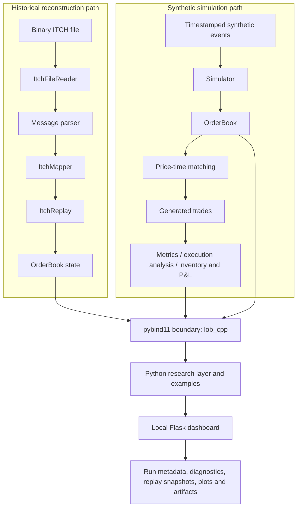
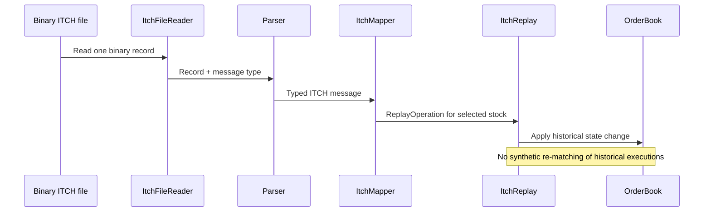

# Architecture

**Project:** Hybrid C++/Python Limit Order Book Simulator  
**Last documentation review:** 2026-10-14

## 1. Scope and status

The project combines a C++ limit order book and synthetic matching engine, historical Nasdaq TotalView-ITCH 5.0 reconstruction, a pybind11 bridge, Python research workflows, and a local Flask dashboard.

The latest reported implementation status is that the core, ITCH replay, bindings, research workflows, and dashboard have been implemented. This document is not a substitute for rerunning the complete test suite from the exact checkout being released; it does not claim that the author’s Windows environment was rebuilt during this documentation review.

This is a **simulation and historical research tool**. It is not a broker gateway, exchange connector, live order router, or evidence of a profitable trading strategy. Avoid treating “HFT” in the repository name as a claim of institutional-grade latency or production readiness.

## 2. System overview

The two input paths share the C++ book representation, but **they do not share the same event semantics**:

- **Synthetic simulation:** a hypothetical event enters `Simulator`; the C++ engine can match an incoming order against resting liquidity and emit `Trade` records.
- **Historical ITCH replay:** a feed message is parsed, mapped to a replay operation, and applied to reconstruct the displayed book. Historical execution/cancel/delete messages are not hypothetical incoming orders and must not be re-matched by the synthetic matching engine.

Python and the dashboard orchestrate workflows, extract observations, calculate research features, and present outputs. They are not a second implementation of the C++ matching engine or historical book mutation.

## 3. C++ ownership model

The C++ core is the source of truth for book state.

- `OrderBook` owns the bid and ask collections, each represented by `std::vector<PriceLevel>`.
- Each `PriceLevel` owns its `std::vector<Order>` and tracks its aggregate `total_quantity`.
- `OrderMap` is an auxiliary lookup from `OrderId` to `OrderLocation{Side, Price, index}`. It stores locations, not owning pointers to `Order` objects.
- When vector erasure shifts orders, the location index for affected orders must be repaired. This is a known cost in removal-heavy workloads.
- Matching follows price-time priority: best price first, FIFO within a level, and trades execute at the resting order’s price.
- The synthetic simulator validates event chronology/sequence and coordinates trade history and downstream accounting.
- Metrics and execution analysis observe existing market state and trades; inventory/P&L is handled by `InventoryModel` above the matching layer.

### Price and quote conventions

Prices are integer-scaled ticks, not binary floating-point currency values. For the configured two-decimal scale, `100.00` is stored as `10000`. Convert ticks to display units only at presentation boundaries and use one consistent scale when importing data.

An empty book side reports `0` from `best_bid()` or `best_ask()`. This is a sentinel for no quote, not a valid tradable price. The current spread convention also returns `0` when either side is unavailable; consumers must not interpret that as a zero-width market when the book is empty or one-sided.

## 4. Main code areas

| Path                            | Responsibility                                                                         |
| ------------------------------- | -------------------------------------------------------------------------------------- |
| `cpp/include/lob/`              | Public C++ types and interfaces                                                        |
| `cpp/src/`                      | Order book, matching, simulation, analytics/accounting, and ITCH implementation        |
| `cpp/bindings/lob_bindings.cpp` | pybind11 registration for `lob_cpp`                                                    |
| `cpp/app/`                      | Native application/test/benchmark entry points present in the checkout                 |
| `python/`                       | Python helpers and research-facing wrappers around the C++ extension                   |
| `examples/`                     | Runnable demonstration and research workflows                                          |
| `benchmarks/`                   | C++ and Python benchmark programs and intentionally retained result files              |
| `scripts/`                      | Build, test, replay, benchmark, example, and dashboard launch scripts                  |
| `tests/cpp/`, `tests/python/`   | C++ and Python-boundary tests                                                          |
| `webapp/`                       | Flask application, API routes, and analysis/run services                               |
| `web/`                          | Browser pages, JavaScript, and styles                                                  |
| `data/itch/`                    | Local historical ITCH source data; do not commit large/licensed raw feeds casually     |
| `results/`                      | Per-run research/dashboard outputs; generated data should be kept separate from source |

A generated `lob_cpp*.pyd` is a platform- and Python-build-specific extension artifact, not portable source. Rebuild it in the target Python/toolchain environment and normally keep it out of version control.

## 5. C++ to Python boundary

`cpp/bindings/lob_bindings.cpp` exposes the existing C++ implementation as the `lob_cpp` extension. Python code imports this extension and uses its bound types and functions. It should not reproduce C++ matching, inventory, P&L, or ITCH mutation rules in Python.

The extension is ABI-sensitive: the Python interpreter used to import it must match the interpreter/toolchain used to build it. On the documented Windows setup, use MSYS2 **UCRT64** consistently for the shell, compiler, Python, and linked runtime. Do not mix UCRT64, MINGW64, system Python, and unrelated Python installations.

One binding detail matters in wrapper code: successful `ItchReplay.apply()` returns Python `None` because the successful C++ `std::monostate` result is bound as `None`. Tests and wrappers must not treat that successful result as a non-null operation object.

## 6. Historical ITCH path

The current C++ reader expects a **decompressed binary ITCH `.txt` file**, not a gzip stream. See [Data and ITCH replay](data.md) for message mapping, filter behavior, counters, snapshot semantics, and the known dashboard upload-format mismatch.

## 7. Research and dashboard path

The Python layer converts C++ state into observations and research outputs. Depending on the workflow, outputs include book snapshots, tabular observations/datasets, summary JSON, diagnostics, and Matplotlib plots. The Python feature benchmark is separate from C++ engine and historical replay benchmarks.

The local dashboard uses Flask routes and services to validate/select input, create a run record, run bounded analysis, persist progress/status, and serve the resulting artifacts to the browser. Its API includes health, run creation/listing, run status, plots/artifacts, replay snapshots, and heatmap data. The bounded ITCH runner calls the C++ extension directly so it can report raw-message progress and message-outcome counters instead of first running the older long-form workflow without visible progress.

Dashboard output is written under `results/dashboard/` by default. The configured defaults include a 512 MB upload cap, up to 20,000,000 raw messages per bounded replay, 10,000 retained replay snapshots, 50 displayed levels per side, and a price scale of 100. These are configuration defaults, not universal performance guarantees; environment variables in `webapp/config.py` can override several limits.

**Operational boundary:** the dashboard is intended for local use. It defaults to `127.0.0.1`; do not expose it to an untrusted network without a separate security review and deployment hardening.

## 8. Performance findings

A recorded end-to-end ITCH run processed 302,347,067 historical messages in about 400.13 seconds (approximately 755,622 messages/second) in the measured environment. This is a historical reference point, not a guarantee for another computer, compiler, dataset, filter, build configuration, or dashboard run. See [Benchmarks](benchmark.md).

Profiling identified two important workload-specific costs: order-index repair after vector erasure in removal-heavy paths, and repeated price-level sorting in synthetic ADD-heavy workloads. These are documented findings, not claims that either cost has been eliminated. See [Profiling](profiling.md).

## 9. Correctness and release checks

Use the repository scripts from the intended MSYS2 UCRT64 environment. At minimum, the release check should rebuild the extension and native tests, run the Python and C++ suites, exercise a small known synthetic example, replay a bounded prefix of a real decompressed ITCH file, and run the dashboard through one successful and one invalid-input case.

The test runner currently builds and invokes the native test executables and runs `pytest` under `tests/python`; it requires `MSYSTEM=UCRT64`. A successful run only establishes the behavior covered by those tests, not exchange fidelity beyond the implemented message subset, trading profitability, or production suitability.

## 10. Data, security, and licensing boundaries

- Do not commit large raw ITCH feeds or generated result trees unless their provenance, size, redistribution rights, and intended use have been reviewed.
- Treat uploaded files and generated artifacts as untrusted input. Keep the dashboard local and respect its size/workload bounds.
- Do not claim that `pybind11` alone proves “zero-copy” behavior. Make performance claims only when the relevant code path and benchmark establish them.
- The root `LICENSE` is authoritative. The public `main` branch checked on 2026-10-14 still contained an MIT license. If moving to PolyForm Noncommercial 1.0.0, replace the root license and synchronize the README and GitHub license metadata before describing that restriction as active. Commercial terms/pricing require a separate written agreement; a future license change does not automatically revoke permissions already granted for old MIT-licensed copies.

## Related documents

- [Data and ITCH replay](data.md)
- [Benchmarks](benchmark.md)
- [Profiling](profiling.md)
- [Documentation index](README.md)
- [Project README](../README.md)
