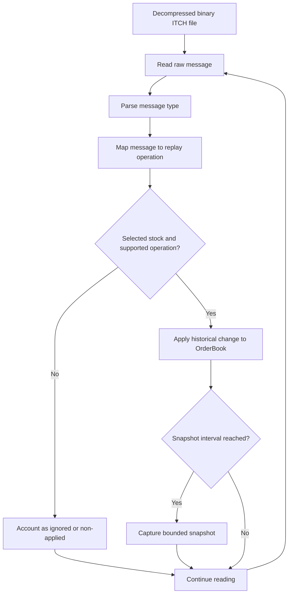

# Data and Historical ITCH Replay

## 1. Purpose

The project can reconstruct a displayed limit order book from historical Nasdaq TotalView-ITCH 5.0 messages. The ITCH path is for historical reconstruction, not for sending hypothetical incoming orders through the synthetic matching engine.

## 2. Input format

The C++ `ItchFileReader` consumes **decompressed binary ITCH records**. A `.txt` extension does not mean the file is ordinary line-oriented text; the file contains binary message records as defined by ITCH 5.0.

A path used by the historical tests is:

```text
data/itch/2019-10-18/decompressed/S101819-v50.txt
```

Store original compressed files and decompressed files in separate, clearly named local directories. Do not assume gzip support in the reader. The dashboard upload route currently accepts a `.gz` filename at validation time, but the bounded C++ replay runner rejects `.gz` streams and instructs the user to provide the decompressed `.txt` file. Decompress the feed before an ITCH replay; do not document `.gz` as a working replay input until the code path is changed and tested.

Historical data is not automatically licensed for redistribution just because the parser is in this repository. Check the data provider's applicable terms and keep raw market data out of commits unless redistribution is explicitly permitted.

## 3. Stock Locate

A `Stock Locate` is the security identifier used within the ITCH feed's relevant session/context; it is not interchangeable with a familiar ticker symbol. Choose it intentionally and confirm the mapping using the feed's Stock Directory/metadata or project tooling before running a large replay. A wrong value can produce few or no book-changing operations even while raw records are being read.

The runner's `max_messages` limit counts raw feed messages consumed, including messages for other securities. Filtering to the selected Stock Locate is a separate stage after a raw message is consumed.

## 4. Implemented message handling

The mapper/replay path supports the following displayed-book operations in the project's implemented subset:

| ITCH type | Interpretation in this replay path |
|---|---|
| `A` | Add order |
| `F` | Add order with attribution/MPID information |
| `E` | Reduce the referenced resting order for an execution |
| `C` | Reduce the referenced order for an execution carrying a price |
| `X` | Reduce the referenced order by the cancelled quantity |
| `D` | Remove the referenced order |
| `U` | Replace an existing order with a new order ID/fields, preserving the required side resolution from the old order when applicable |
| `R`, `S` | Not used to mutate the displayed order book in this replay path |

This table describes the implementation, not a complete specification of every Nasdaq ITCH 5.0 message type. Unsupported, metadata, and non-book-changing message types may be ignored or accounted as non-applied, according to the mapper and runner's result handling. Consult the actual parser/mapper code when extending support.

### Why historical executions are not matched again

An ITCH execution is an observation of an event that already occurred at the exchange. The historical replay reduces the corresponding resting quantity directly. Treating that event as a new incoming synthetic order would execute it twice and corrupt the reconstructed book. The synthetic `Simulator`/matching engine is used for hypothetical events; `ItchReplay` applies historical book changes.

## 5. Bounded dashboard replay

The dashboard replay runner exposes these important parameters:

- `file_path`: path to the decompressed binary ITCH file.
- `stock_locate`: selected feed security.
- `max_messages`: raw messages to consume; `None` means read until EOF. The dashboard's configured limit uses `0` to request the full file.
- `snapshot_interval`: capture cadence counted in successful selected-stock `ItchReplay.apply()` operations, not raw message positions.
- `levels_per_side`: maximum price levels included per snapshot.
- `max_snapshots`: upper bound for retained snapshots.

The saved `message_index` identifies a position in the raw feed. It is not the count of selected-stock book updates.

Snapshot storage is bounded. The runner retains the first usable snapshot, deterministically samples interior snapshots, and preserves the final state when successful book updates occurred after the most recent scheduled snapshot. Therefore the number of retained snapshots may be lower than the number of snapshot opportunities seen, and it should never be confused with the number of messages read.

## 6. Progress and counter invariants

The dashboard reports raw messages consumed and outcomes. The six message-outcome categories are:

- `applied_messages`
- `ignored_different_stock_locate`
- `non_applied_messages`
- `failed_applications`
- `parse_errors`
- `mapping_errors`

The runner reports `messages_accounted` as the sum of these outcome categories and checks that:

```text
messages_accounted == messages_read
```

`messages_read` is the number of raw messages consumed. `snapshots_captured` is an independent snapshot count and is **not** included in the message accounting equation. Reader failures occur before a raw message has been counted as consumed.

Progress percentage is a UI estimate based on the requested bounded workload when a message limit is known. A percentage or advancing counter does not alone establish that the selected Stock Locate, input format, or resulting book is correct; check the final summary and output artifacts too.

## 7. Typical processing flow



## 8. Outputs and reproducibility

A dashboard run stores run metadata plus files under its own `results/dashboard/runs/<run-id>/output/` directory. Outputs can include `replay.json`, diagnostics, logs, generated plots, and other workflow artifacts, depending on the input route. Research examples may instead write to their own `results/` subdirectories.

For any research result, record the feed/file identifier, date, Stock Locate, raw-message limit, snapshot interval, price scale, relevant software version, and feature definitions. Keep the raw source data separate from generated data so another run can identify exactly what was used.
